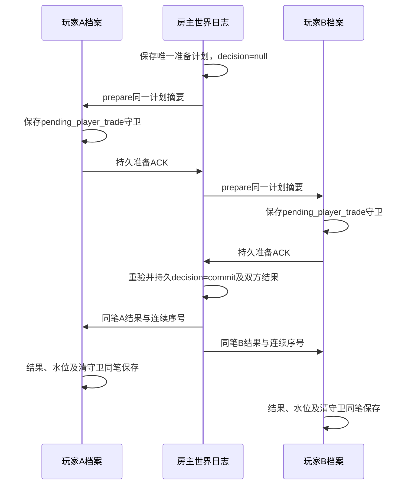

# 71 局域网双人交易与恢复采用合同

更新日期：2026-11-14。状态：项目协议设计采用，未实现。[唯一合同](contracts/玩家交易.v1.json)定义真实LAN两名玩家的面对面交换与单向赠予；[结构schema](contracts/玩家交易结构.schema.json)只约束完整单侧报价或持久准备守卫，不是完整档案、世界日志、物品堆或收据schema。

## 范围与入场

当前明确可交易定义为[67名匠水晶符](67-普通首饰加工采用合同.md)1种及[70新版武勋首饰](70-新版武勋首饰成长与套装采用合同.md)9款，逐个登记精确ID和转让适配器。其他明确禁止交易的物品不能用本协议解绑；未来正式定义声明可交易却没有适配器时属于配置错误。玩家交易权限覆盖仍须逐字段采用，不能放宽未知实例/绑定结构。

双方须是同房、不同角色、独立单写档案的在线活体，脱战空闲、同一允许公共地图、脚位置距离至多3米。当前独立采用21个公共地图ID，修炼房/私场不开放。不限同队或同派，最低1级0转，不把角色等级当接收高阶物品的条件。NPC商店与离线NPC行为继续沿17，不能显示假玩家成交。

入场前双方经济结果连续确认水位须齐全，无活动、传送、其他交易或待决准备守卫。邀请先占用双方角色，防交叉邀请；接收方明确接受后才能报价，30秒未接受过期。

交易期间隔离双方移动/攻击/用物/拾取/任务/仓储/切组/配置等玩法意图，聊天和设置可用，世界及合法敌人/时钟继续。提交前受伤、死亡、距离/地图变化或影响钱物/资格的修订变化取消交易，不能靠交易暂停敌人或称号期限。

## 报价、锁定和确认

每侧最多8条物品条目及一项非负精确随身银两。条目只提供`kind/target_id/source_revision/quantity`，定义与真实属性由房主从原库存读取；唯一实例数量精确1，同一源ID只能出现一次。材料数量不得超过源真实可用量与定义堆上限。

只能送本人装备包实例或材料背包实际堆，且定义及实际绑定均允许转让、无任务/到期/其他操作保护。已穿、备用组、仓库、复购、他人或NPC库存不能自动挪来交易。仓银不支用，双方银两即使互相抵消也须分别原本足够支付。

报价只预留原物引用和可付银额，不复制托管背包、不扣钱、不拆堆、不改耐久。赠予允许一侧全空；双方都空不能确认。取消保原物数量、ID和耐久。

| 状态 | 可推进事件 | 关键条件 |
| --- | --- | --- |
| invited | 接受→editing | 接收方认证、未过期、入场条件仍合法 |
| editing | 改报价、锁定 | 实际变更才增报价修订；双方锁定后进入reviewing |
| reviewing | 双方分别最终确认 | 显示精确同一计划，第二方确认后持久准备计划→preparing |
| preparing | 双方持久准备ACK | 房主重验并持久commit→committed |
| committed | 各方应用保存并ACK | 双方确认水位持久成功→completed |
| completed | 重试查询 | 只返回原结果 |
| aborted | 重试查询 | 只返回原取消决定 |

双方任一已锁定时不能修改报价；显式解锁同时清双方锁定及确认，回editing。锁定与最终确认分开，确认绑定当前世界/交易/报价修订/协议修订和计划摘要。旧确认、同名物品展示或单方确认不能代双方同意。任何有效协议状态改变递增`trade_revision`，内容实际改变才递增`offer_revision`；重复请求先去重。

预览展示双方角色、精确物品及数量/加工/耐久/绑定、送出/接收、最终格重与银两、赠予标识、税0及新版首饰归0耐久。编辑无有效操作120秒取消，重发、心跳、状态查询不续时；preparing固定30秒，不因收到一个ACK重新计时。会话单调绝对时钟不跨重启保存。

## 同笔交换的计算

房主先验证两侧完整原库存，再在副本同时移除两侧输入，计算加入对方输入后的实际布局/格重/余额。满包一换一可用送出腾出的格；任一侧最终超重、满包、负余额或溢出，整笔拒绝。

银两采用`A后=A前−A报价+B报价`，B对称；各侧原报价可付且最终在安全整数范围。税0、不发经验/武勋等额外收益。报价与结果运算均使用严格整数及乘加溢出检查。

唯一实例按对方报价条序放最低空槽，保原实例ID、血统、创建和加工历史，更新owner与真实转让来源。新版9款仅成功提交时将耐久归0，所有权和耐久来源指同一事件，实例修订加1。接收不自动穿戴或满足称号资格。

材料全量送出移除源堆，部分送出保原堆ID减量；接收先按稳定槽/堆ID填满同定义、绑定、有效期和普通材料属性完全一致的堆，余量按定义上限生成新堆并放最低空槽。接收方新堆不复用源堆ID；多源合并保各来源流量，不只留一条购买收据。存续变更堆修订每笔只加1，新堆从0；全量消费源不保0数量空堆。

交易ID由房主预留持久单调计数产生，取消或崩溃留下编号缺口但不重用。它与19连续结果序号不同；`settlement_id`等于`trade_id`，接收方新堆ID由交易/接收角色/计划输出序号确定。预演与恢复不重新分配ID，也不消费玩法随机。

## 双方持久准备与房主决定

仅房主先写成交结果而卖方还没保存，无法阻止卖方正常退回旧离线库存。因此在成交决定前增加双方持久准备屏障。准备守卫只保存世界/交易/角色/原修订/摘要与原物指纹，不另存一份可用钱物。

准备计划及最终决定由`world.player_trade_journal`唯一持有，是19世界结算日志的trade类型；通用日志引用它，不复制第二份全量结果。房主先持久完整准备计划再发prepare，两侧各自持久守卫成功才ACK，房主记录每侧准备ACK。房主自己的角色遵守相同流程。

守卫是协议元数据，不改变原角色业务修订；写档仍遵守整个档案单写锁和完整快照。守卫存在时该角色不能离线、进别房、删除或配置资源继续消费原钱物；退出只保待决只读状态，同档其他角色仍可选择。准备保存失败不ACK、不丢守卫草稿伪装成功。

双方准备ACK齐全后，房主在固定步再次验证原状态、双方在线、内容版本与完整结果，再同一权威文件替换持久commit决定、两方结果序号及世界修订。替换成功才发布钱物结果。保存失败不发布，不重新算计划或更换ID；原状态已变化则走持久abort。

commit之后每侧按19连续序号和前修订应用；准确结果、`network_receipts`及清守卫在该侧自身档案同笔替换，成功才ACK。保存失败只重存原结果，暂禁该角色新资源事务。已保存并获房主持久确认的一侧可继续玩法，不等待另一侧文件修好；原交易仍标committed，直到双方都完成才标completed。

跨机器文件不能同时原子替换。协议保证房主决定不可变、每角色按同结果应用、未决旧钱物不可被正常流程继续消费；不将这个保证写成全体档案瞬间同时保存。

## 取消、断开和重启

准备前取消只释放引用，原钱物无变化。preparing后取消、超时、准备失败、断开或外部状态改变，须先房主持久abort再向双方解除守卫；房主写失败不能先发“已取消”让一侧清守卫。

解除只清协议元数据，不拿准备前整份角色覆盖当前合法变化。commit的完整结果快照从当步当前角色复制后应用计划中的经济投影，保留合法计时及未改字段。

commit替换成功是不可逆业务决定。此后断线、取消、另一侧保存失败只能重发原结果等待确认，禁止退钱退物、反向补发或以晚到取消覆盖commit。邀请/编辑/准备的超时不能删除已成交待确认记录，120秒房间席位释放也不删除它。

原房主重开按唯一journal决定恢复：commit重发原结果，abort重发解除；decision仍null的准备计划一律先持久abort再通知。不能从一侧已准备、时间戳或没有收到消息推断成交。

若文件替换返回不确定结果，停止该交易新发布/解除，只重读同一正式档案内的journal并核格式、交易ID、摘要与决定，再走对应恢复分支。读取失败或坏档保守卫并报错，不挑临时文件/备份猜决定，不盲重试新成交。

若角色守卫存在而原房主不可达或权威计划缺失，保守卫并明确等待/损坏原因，不自动清空、补退或切到另一世界消费资源。这是已准备跨机事务必须等待原决定的边界；手动改档、回滚备份或恶意房主不属于正常协议防作弊承诺。

同请求ID同参数先回原结果，同ID异参数拒绝。所有锁定、确认、prepare ACK与最终结果均核世界/角色/交易/版本/摘要，迟到消息不得作用新交易。已应用同笔结果可在持久水位核验后再ACK，不要求它还保留已清除守卫。

未持久的邀请/编辑会话在房主进程重启后过期，旧连接token不能在新连接重放创建邀请。重连按原交易ID查询持久决定，新邀请须新的显式命令。

## 日志、来源与配置

双方commit结果连续确认或abort守卫解除确认只是将来压缩的必要条件；当前没有已采用完整压缩证明协议，保原全部准备/决定计划、结果与来源，不裁剪为仅摘要墓碑。未确认记录不按时长/条数淘汰，空间不足停止新业务。

摘要采用合同规定的确定UTF8 JSON编码及SHA256，明确对象排序、整数、Unicode和控制字符转义，不用引擎默认键序。它验证相同计划与损坏，不是数字签名。

新owner仍需完整创建/加工/转让来源闭包；不能只保一个哈希却删掉以后验证必需的收据。双方保存闭包仍不自动授权房主丢全量副本，当前完整记录保留。通用完整档案/堆/来源收据schema仍待联审。

新角色与四种已知旧档导入显式`pending_player_trade=null`；新世界`player_trade_journal={}`、`player_trade_next_id=0`。现有新格式缺字段拒绝，不通过普通读档补交易字段。参数中心不能清待决guard来制造已取消或已成交；解除只能依据原房主决定。

## 验证边界

D1检查须覆盖当前10个适配器与权限、21地图、状态迁移/取消阶段、报价/guard严格结构、银量与材料流守恒、满包一换一、两侧溢出/超重拒绝、首饰成功归0与取消不变，以及每个持久边界的崩溃恢复推演。

P/T须实际验证两客户端与房主自身参与、双方锁定/改价/迟到确认、赠予、材料合并、prepare任侧保存失败、房主commit前后退出、只一侧应用/保存、乱序重发、缺日志/分支拒绝及跨机LAN。静态状态与算例、报价/守卫schema通过不证明这些运行功能已实现；完整档案/库存/来源与其他D1继续待办。

[72堆与数量来源](72-物品堆与数量来源校验合同.md)细化接收堆ID为stack:加确定JSON数组[trade_id,接收角色ID,该角色新堆0起序号]的SHA256小写摘要。堆流输入消费完整旧版本、输出保全部分量及接收方既有堆前链，按原计划提交与重放。完整经济收据/档案仍待，本协议不因此成为已实现。

原交易journal结构现采用[原schema](contracts/玩家交易结构.schema.json)的host_record/plan/decided_record，不另存第二成交收据。participants为两完整原LAN会话身份；双方预演保存两修订/配置修订/指纹、报价及两个随身容器布局，三类共同来源流只在plan.transfer_provenance一处。plan_digest沿71精确编码world_id/protocol_version/rules_hash/trade_id/offer_revision/participants/plan七键；准备ACK与决定不进摘要。null决定无正式结果引用，commit/abort各保双方原连续seq引用，终态记录由[网络封套](contracts/网络结果链.v1.json)引用。commit须两原准备保存证明且才授权候选流，abort不执行流、不回滚外部合法变化。结构不证明原输入/摘要/守恒或真实存盘，完整角色/world/来源联审仍待。

衣饰交易适配已采用：精确1152未绑定衣饰与既有9首饰/1名匠符合计1162定义、3种适配类型；完整衣饰保11键，不套首饰耐久字段。原host_record增为13键，clock_reconciliation_or_null仅在提交正余时衣饰时保存真实T及索引/余时见证。冻结计划和七键摘要保持完整，来源图与角色after先按原时钟父证明派生唯一实际流；到期改头须abort，不能恢复旧余时。实际父证明/完整根/Windows与LAN仍待，D1未完成。
